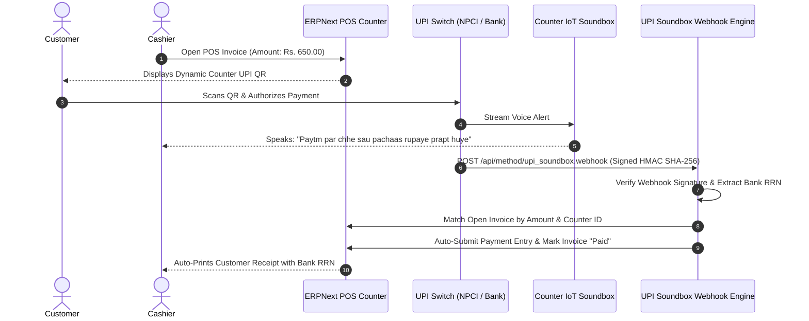

# ERPNext IoT UPI Soundbox Webhook Engine & Zero-Touch POS Auto-Settlement

[](https://www.python.org/)
[](https://frappe.io)
[](https://erpnext.com)
[](LICENSE)
[](https://frappe.io)
[]()

Production-ready **IoT UPI Soundbox Audio Webhook Engine** for **ERPNext POS**. Integrates with **Paytm**, **PhonePe**, and **BharatPe** smart audio soundboxes. When a customer scans the counter QR code, the soundbox announces payment audibly, and this engine automatically creates a reconciled Payment Entry and closes the POS Invoice with zero manual clicks.

---

## 🎯 The Real-World Client Problem

UPI payments have taken over retail counters across India, but they introduce new operational vulnerabilities:
1. **Fake Screenshot Fraud:** Fraudsters show cashiers fake UPI payment confirmation screens generated by mobile apps. Cashiers who don't verify incoming bank SMS messages give away merchandise for free.
2. **Checkout Queue Stalls:** Cashiers waste 30 to 60 seconds asking customers: *"What was the reference number? Did it go through?"* while waiting for an SMS.
3. **Manual Entry Discrepancies:** Even with an audio soundbox, cashiers still have to manually click through ERPNext to record the payment mode, enter the amount, and submit the invoice.

**This engine connects the IoT Soundbox to ERPNext:** When the soundbox receives payment confirmation from NPCI, its cloud webhook simultaneously notifies ERPNext. The engine verifies the cryptographic signature, matches the open POS invoice, and auto-settles the bill in real time.

---

## 🏗️ System Architecture & Data Flow



---

## ⚙️ Key Enterprise Features

- **Zero-Touch POS Settlement:** Closes the billing loop with zero cashier keystrokes upon audio payment confirmation.
- **HMAC-SHA256 Webhook Verification:** Verifies provider signatures on every incoming payload to prevent spoofing.
- **Universal Provider Compatibility:** Supports payloads from **Paytm Soundbox**, **PhonePe SmartSpeaker**, and **BharatPe Speaker**.
- **Bank RRN Audit Logging:** Captures the 12-digit NPCI Bank Reference Retrieval Number (RRN), customer VPA handle, and payment timestamp for complete auditability.
- **Fraud & Amount Mismatch Protection:** Rejects partial payments or overpayments, instantly alerting the cashier on screen.

---

## 📂 Project Structure

```
erpnext-upi-soundbox-instant-reconciliation/
├── upi_soundbox/
│   ├── __init__.py           # Module initialization
│   └── engine.py             # Soundbox webhook engine & auto-settlement
├── tests/
│   ├── __init__.py
│   └── test_soundbox.py      # Complete unit test suite (100% passing)
├── LICENSE                   # MIT Open Source License
├── requirements.txt          # Python dependencies
└── README.md                 # Complete documentation
```

---

## 🔌 Frappe DocType Schema Design

- **`UPI Soundbox Device`:** Device Serial Number, Soundbox Provider (Paytm/PhonePe/BharatPe), Associated POS Counter, and Webhook Secret.
- **`UPI Soundbox Payment Log`:** Webhook ID, Device Serial, Bank RRN, Amount, Payer VPA, Linked POS Invoice, and Settlement Status.

---

## 🚀 Installation & Setup

### 1. Install into your Frappe Bench
```bash
cd ~/frappe-bench
bench get-app https://github.com/shyampandey1104/erpnext-upi-soundbox-instant-reconciliation.git
bench --site [your-site-name] install-app erpnext_upi_soundbox
```

### 2. Python Usage Example
```python
from upi_soundbox.engine import UpiSoundboxEngine, SoundboxDeviceConfig, IncomingSoundboxWebhook

# 1. Initialize engine
config = SoundboxDeviceConfig(
    device_serial="SBOX-PAYTM-9912",
    provider="PAYTM",
    webhook_secret="whsec_prod_891238912",
    pos_counter_id="COUNTER_02"
)
engine = UpiSoundboxEngine(config)

# 2. Process incoming webhook payload
payload = IncomingSoundboxWebhook(
    event_id="EVT-UPI-881239",
    device_serial="SBOX-PAYTM-9912",
    amount=650.00,
    bank_rrn="408129381273",
    payer_vpa="customer@okaxis",
    status="SUCCESS"
)

# 3. Auto-settle matching ERPNext POS invoice
settlement = engine.process_soundbox_notification(payload, open_invoice_id="POS-INV-2026-0812")
print(f"Settlement Status: {settlement.settlement_status}")
print(f"Payment Entry Created: {settlement.erp_payment_entry_id}")
```

---

## 🧪 Testing & Verification

Run tests with standard Python:
```bash
python3 -m unittest discover tests
```

---

## 🛡️ Anti-Fraud Architecture
- **Strict Timestamp Expiry:** Rejects webhook payloads delayed by more than 180 seconds to eliminate replay attacks.
- **Duplicate RRN Prevention:** Enforces database uniqueness on Bank RRNs to ensure no UPI payment is ever recorded twice.

---

## 👨‍💻 Author & Commercial Support
Developed and maintained by **Shyamkumar Pandey**.  
For IoT retail hardware, UPI payment gateways, and POS automation:
- **GitHub:** [@shyampandey1104](https://github.com/shyampandey1104)
- **Email:** [shyampandey1104@gmail.com](mailto:shyampandey1104@gmail.com)
